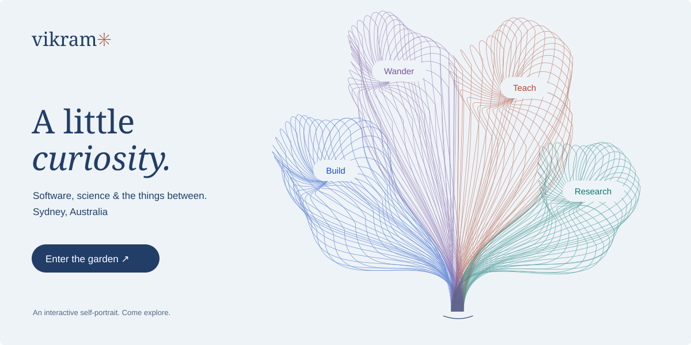

  <a href="https://vikramwish.github.io/vikramwish/"><strong>Enter the living garden</strong></a> · Move to bend the threads. Pick a branch. Grow something new.

I'm **Vikram**, a final-year **Software Engineering (Honours)** student at the **University of Sydney**, graduating in **2027**. I build reliable software, and I'm looking for a graduate software engineering role starting in February.

#### Every branch has a story. Unfold one.

<strong>⌘ Build — make it work, make it reliable</strong>

 

**Software Engineer · Cogniti · Summer 2025**

Wrote a **70+ case Selenium end-to-end suite** that cut release time by **50%**, from six weeks to three. Supported the **AWS Lambda to Azure migration** for a platform serving **70,000+ students across 22 institutions**.

**Software Engineering Intern · Zoho · Dubai · 2022–2023**

| What I work with | Tools |
| :--- | :--- |
| Programming | Python, HTML, CSS, Bash |
| Testing & delivery | Selenium, Playwright, GitHub Actions, Docker |
| Cloud & integration | Microsoft Azure, Azure Cosmos DB, AWS Lambda, REST APIs, MCP |
| AI coding tools | Claude Code, Codex, Cursor, GitHub Copilot |

[Explore my repositories ↗](https://github.com/vikramwish?tab=repositories)

<strong>✺ Teach — understanding grows when you share it</strong>

 

**Casual Academic & Head TA · University of Sydney · 2026–present**

Python labs and tutorials for **ENGG1810**, with a first-year cohort of **1,300+ engineers**.

<strong>❋ Research — follow the question</strong>

 

**Research Assistant · Cornell University · 2025**

Benchmarked degree structures across **15+ peer institutions**.

**Research Engineer · University of Sydney · 2023–2024**

Contributor to a **peer-reviewed publication on chem-resistive gas sensor arrays**.

<strong>✧ Wander — a few places, many perspectives</strong>

 

I've studied or worked in **Australia, the USA, India, the Netherlands and the UAE**. I'm a **New Zealand citizen**, currently in Sydney.

| Along the way | What I studied |
| :--- | :--- |
| University of Sydney | Bachelor of Software Engineering (Honours), graduating 2027 |
| Cornell · exchange, 2025 | Software Systems Engineering **(A+)**, Building LLM Applications **(A+)** |
| UCLA · summer exchange, 2024 | A third university, another perspective |

 

[Let's connect on LinkedIn ↗](https://www.linkedin.com/in/vikram-vish/) · [Explore the garden ↗](https://vikramwish.github.io/vikramwish/)

The garden is drawn with code. Every new growth is a different drawing, and you can keep one as an SVG. No trackers, no external scripts, just a little curiosity.
